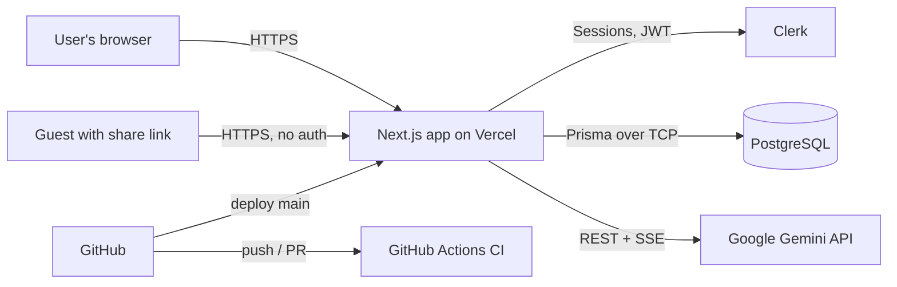
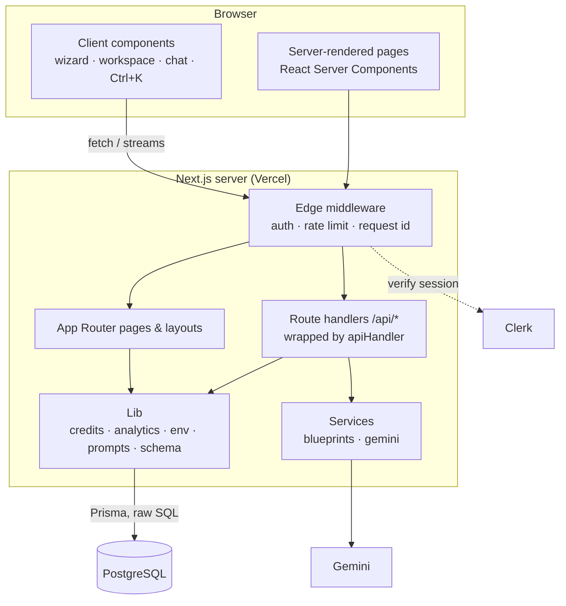
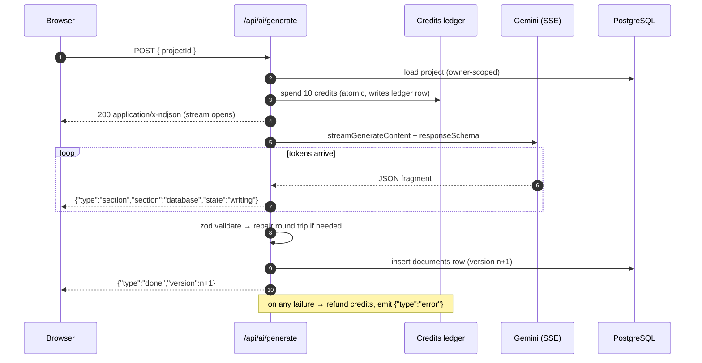

# High-Level Design — ProjectAI

This document describes the system's components, how they connect, and the key architectural decisions. Implementation details (tables, endpoints, sequences) are in [LLD.md](./LLD.md).

## 1. System context

| External system | Role |
|---|---|
| **Clerk** | Sign-up, sign-in, sessions, user profile. The app stores only the Clerk user id. |
| **PostgreSQL** | All application data (projects, versions, tags, ledger, conversations). |
| **Google Gemini** | Blueprint generation, section rewrites, brief enhancement, chat. |
| **Vercel** | Hosting, serverless functions (60 s limit), preview deploys. |
| **GitHub Actions** | Lint, typecheck, AI smoke tests and build on every PR. |

## 2. Container view

### Layers

| Layer | Location | Responsibility |
|---|---|---|
| **Middleware** | `src/middleware.ts` | Runs before every request: Clerk auth (public allow-list), per-user sliding-window rate limits, `x-request-id` propagation. |
| **Pages & layouts** | `src/app/**` | Server Components fetch data directly with Prisma. The project layout is shared by all tabs. |
| **Route handlers** | `src/app/api/**` | JSON or streaming endpoints, each wrapped in `apiHandler` (error mapping, logging). |
| **Services** | `src/services/` | `gemini.ts`: provider client (retry, SSE, structured output). `blueprints.ts`: generation, versioning, persistence. |
| **Lib** | `src/lib/` | Validated env, credits ledger, SQL analytics, zod schemas, stream helpers, pricing. |
| **Prompts** | `src/prompts/` | Versioned prompt templates and injection guards. |

## 3. Key flows

### 3.1 Blueprint generation (streamed)

### 3.2 Project-aware chat

1. The client sends `{ conversationId?, projectId?, message }`. It never sends the history.
2. The server loads the last 20 messages from the database, plus a compact projection of the project's latest blueprint.
3. The server waits for Gemini's first token before returning `200`, so early failures come back as proper JSON errors.
4. The reply streams as `text/plain`. The client renders it at most once per animation frame.
5. On completion or Stop, the assistant message is saved. Stopped replies are marked "(stopped)".

### 3.3 Section refinement and versioning

Every change to a blueprint (full generation, section rewrite, manual edit, restore) **appends** a new `documents` row with `version = max + 1`, a `source` and a `note`. Nothing is overwritten, so history is complete and restore is just "copy version k into version n+1".

## 4. Architectural decisions

| # | Decision | Why | Trade-off |
|---|---|---|---|
| ADR-1 | **Next.js App Router monolith** (UI + API in one deployable) | One repo, shared TypeScript types, server components query the DB directly | Long-running AI work is bound by the serverless timeout (60 s) |
| ADR-2 | **PostgreSQL only** (no document store) | Relational data (users ↔ projects ↔ tags ↔ ledger) needs FKs and JOINs; blueprints fit in a `jsonb` column | Blueprint internals aren't individually indexed (not needed) |
| ADR-3 | **Append-only blueprint versions** | Safe experimentation, audit trail, trivial restore | Storage grows with each edit (blueprints are ~20–40 KB) |
| ADR-4 | **One zod schema → Gemini responseSchema + validation** | Model output and app types can't drift; constrained decoding cuts parse failures | Gemini's schema subset can't express min counts, which zod checks after decoding |
| ADR-5 | **Streaming NDJSON for generation, plain text for chat** | Progress feedback within seconds; simple to parse in the browser | Errors mid-stream travel as events, not HTTP status codes |
| ADR-6 | **Credit ledger as the source of truth** with a cached balance | Explains every change, supports refunds and analytics | Two writes per spend (done in a single transaction) |
| ADR-7 | **In-memory rate limiting in middleware** | Zero infrastructure for a single-region app | Not shared across instances; swap for Redis when scaling |
| ADR-8 | **Tabs as nested routes** | Deep links, back button, prefetching; the layout keeps the chat drawer mounted | More route files than a single tabbed component |
| ADR-9 | **Env validated at boot** (`instrumentation.ts`) | Misconfiguration fails at deploy, not on a user's first request | CI builds set `SKIP_ENV_VALIDATION=1` |

## 5. Security model

- **Authentication:** Clerk middleware protects everything except `/`, `/sign-in`, `/sign-up`, `/share/*` and `/api/health`.
- **Authorisation:** every query filters by the owner (`where: { id, userId }`). Version lookups go through `project.userId`. Updates use `updateMany`/`deleteMany` with the owner filter, so another user's id returns 404, not 403.
- **Secrets:** `src/lib/env.ts` is `server-only`. Only `NEXT_PUBLIC_*` reaches the browser.
- **AI safety:** user text is wrapped in tags, the tags are stripped from input, the model is told that tagged content is data, and model output is schema-validated before it is stored.
- **Rendering:** chat Markdown ignores raw HTML. The PDF export escapes all fields and runs no scripts.
- **Sharing:** share tokens are 144-bit random, revocable, and marked `noindex`.
- **Headers:** HSTS, X-Frame-Options DENY, nosniff, Referrer-Policy, Permissions-Policy.

## 6. Scalability and operations

| Concern | Current approach | Next step |
|---|---|---|
| AI latency | Streaming + progress events | Background jobs (queue) for >60 s generations |
| AI transient errors | Retry with exponential backoff and jitter | Circuit breaker, provider fallback |
| Rate limiting | Per-instance sliding window | Upstash Redis |
| DB load | Indexed `(userId, updatedAt)`, `(projectId, type, version)`; parallel queries | Read replica for analytics |
| Observability | Request id in every log line; `/api/health` | Sentry + structured logging |
| Delivery | Feature branches → PR → CI → merge → Vercel | Preview DB branches per PR |
