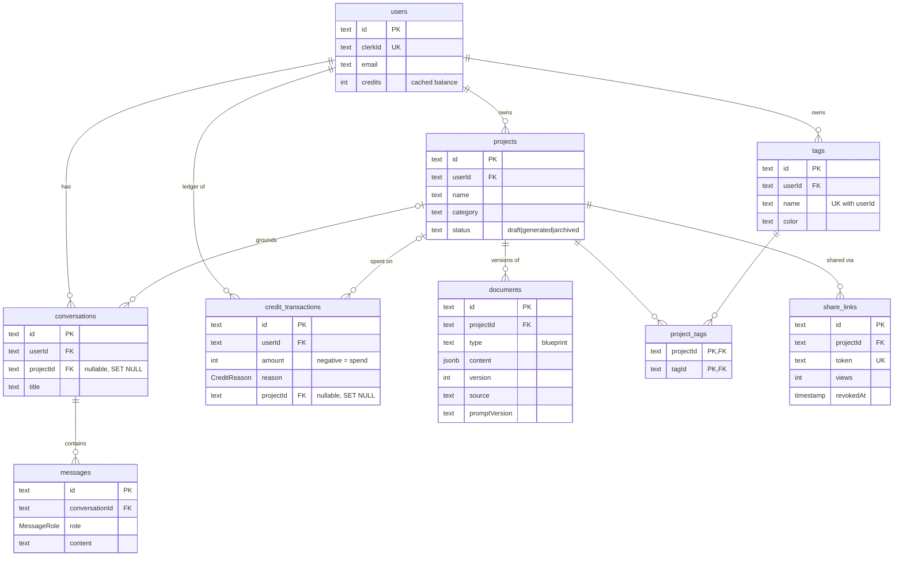
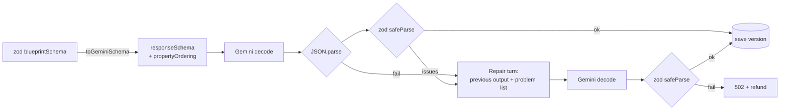
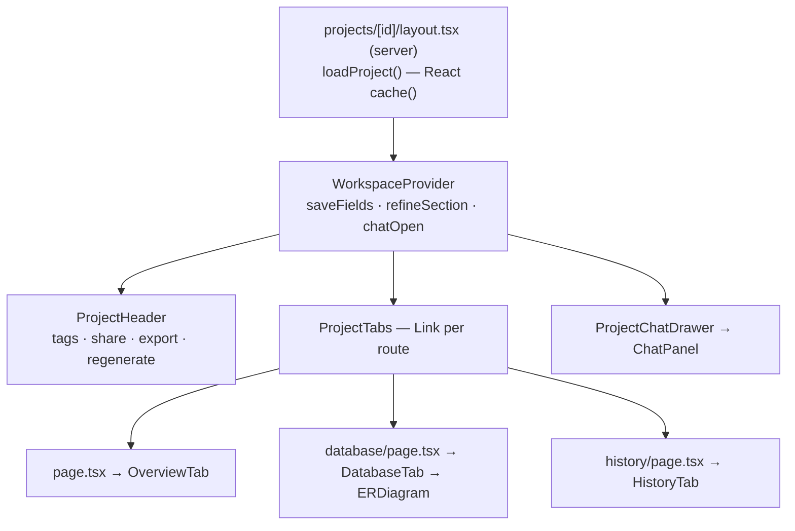

# Low-Level Design — ProjectAI

Companion to [HLD.md](./HLD.md). Covers the data model, API contracts, module internals, AI pipeline and frontend structure. The generated DDL is in [schema.sql](./schema.sql) (`npx prisma migrate diff --from-empty --to-schema-datamodel prisma/schema.prisma --script`).

---

## 1. Data model

### 1.1 Entity-relationship diagram



### 1.2 Tables

| Table | Purpose | Keys and constraints | Indexes |
|---|---|---|---|
| `users` | One row per Clerk user, created lazily on first request | PK `id`; UK `clerkId` | — |
| `projects` | A product idea and its brief | PK `id`; FK `userId → users` **CASCADE** | `(userId, updatedAt)`, `(userId, status)` |
| `documents` | Append-only blueprint versions | PK `id`; FK `projectId → projects` **CASCADE** | `(projectId, type, version)` |
| `tags` | User-defined labels | PK `id`; FK `userId → users` **CASCADE**; UK `(userId, name)` | — |
| `project_tags` | M:N junction table | **Composite PK** `(projectId, tagId)`; both FKs **CASCADE** | `(tagId)` for reverse lookups |
| `share_links` | Public read-only access | PK `id`; UK `token`; FK `projectId → projects` **CASCADE** | `(projectId)` |
| `credit_transactions` | Credit ledger | PK `id`; FK `userId` **CASCADE**; FK `projectId` **SET NULL** (ledger survives project deletion) | `(userId, createdAt)` |
| `conversations` | Chat threads, optionally grounded in a project | PK `id`; FK `userId` **CASCADE**; FK `projectId` **SET NULL** | `(userId, updatedAt)`, `(projectId)` |
| `messages` | Chat turns | PK `id`; FK `conversationId` **CASCADE**; `role` enum | `(conversationId, createdAt)` |

**Invariant:** `users.credits = SUM(credit_transactions.amount)` for that user. Every spend and refund writes both, in one transaction. `prisma/seed.ts` backfills an opening-balance row for databases created before the ledger existed.

**Why `jsonb` for blueprint content:** a blueprint is read and written as a whole, always validated by zod, and never queried by inner field in hot paths. Analytics that need inner fields can still use `jsonb_array_elements`.

### 1.3 Reporting queries (`src/lib/analytics.ts`)

All are `$queryRaw` tagged templates, so every `${value}` is a bound parameter.

| Function | SQL technique | Used by |
|---|---|---|
| `getCategoryBreakdown` | `projects LEFT JOIN documents`, `COUNT(DISTINCT)`, `GROUP BY` | Dashboard chart |
| `getDailyCreditUsage` | `generate_series` **LEFT JOIN** ledger to zero-fill days, `SUM … FILTER (WHERE …)` | Dashboard, Settings |
| `getCreditActivity` | Ledger **LEFT JOIN** projects (deleted projects show as null), `LIMIT/OFFSET` | Activity feed, ledger pagination |
| `getTagUsage` | `tags LEFT JOIN project_tags`, `GROUP BY t.id` | `/api/tags`, tag manager |
| `getProjectsWithoutBlueprint` | **Anti-join**: `LEFT JOIN documents … WHERE d.id IS NULL` | "Waiting for a blueprint" |
| `getOverview` | Scalar subqueries, each `documents JOIN projects` on owner | Dashboard stats |

---

## 2. API

All routes except `/api/health` require a Clerk session. Every handler is wrapped in `apiHandler` (`src/lib/api.ts`):

```
request ─▶ middleware (auth, rate limit, x-request-id) ─▶ apiHandler ─▶ handler
                                                             │
          ApiError(status, msg) ─────────────────────────────┼──▶ { error } with status
          any other throw ───────────────────────────────────┴──▶ 500 { error, requestId } + server log
```

Bodies are validated with zod via `parseBody`. Invalid bodies return `400 { error, issues }`.

### 2.1 Endpoints

| Method | Path | Body | Response | Notes |
|---|---|---|---|---|
| GET | `/api/health` | — | `{ status, db, latencyMs }` | Public; 503 when DB is down |
| GET | `/api/projects?limit` | — | `{ projects }` | Ordered by `updatedAt` |
| POST | `/api/projects` | `ProjectInput` | `201 { project }` | Status `draft` |
| GET | `/api/projects/:id` | — | `{ project }` | With documents |
| PUT | `/api/projects/:id` | partial `ProjectInput` + `status` | `{ project }` | Strict schema |
| DELETE | `/api/projects/:id` | — | `{ success }` | Cascades |
| POST | `/api/projects/:id/duplicate` | — | `201 { project }` | Copies tags + latest version |
| PUT | `/api/projects/:id/tags` | `{ tagIds[] }` | `{ tags }` | Replaces the set; checks ownership |
| PUT | `/api/projects/:id/blueprint` | `{ patch: Partial<Blueprint>, note? }` | `{ blueprint, version }` | Manual edit, free |
| POST | `/api/projects/:id/sections` | `{ section, instruction? }` | `{ blueprint, version }` | AI rewrite, 3 credits |
| GET | `/api/projects/:id/versions` | — | `{ versions[] }` | Metadata only |
| GET | `/api/projects/:id/versions/:vid` | — | `{ version: { blueprint } }` | |
| POST | `/api/projects/:id/versions/:vid` | — | `201 { version }` | Restore = copy to new version |
| GET/POST/DELETE | `/api/projects/:id/share` | — | `{ link \| null }` | Get / create-or-reuse / revoke all |
| POST | `/api/ai/generate` | `{ projectId }` | **NDJSON stream** | 10 credits; see §3.2 |
| POST | `/api/ai/enhance` | `{ name, category, description, audience?, features? }` | `{ suggestion }` | Free; AI rate limit |
| POST | `/api/chat` | `{ conversationId?, projectId?, message }` | **text stream** + `x-conversation-id` | See §3.3 |
| GET | `/api/conversations?projectId` | — | `{ conversations[] }` | With project name |
| POST | `/api/conversations` | `{ projectId?, title? }` | `201 { conversation }` | |
| GET/PATCH/DELETE | `/api/conversations/:id` | PATCH `{ title }` | | GET includes messages |
| GET/POST | `/api/tags` | POST `{ name, color }` | `{ tags }` / `201 { tag }` | 409 on duplicate name |
| PATCH/DELETE | `/api/tags/:id` | `{ name?, color? }` | | |
| GET | `/api/user` | — | `{ user }` | Includes balance |
| DELETE | `/api/user` | — | `{ success }` | Deletes DB rows + Clerk user |
| GET | `/api/user/credits?page` | — | `{ balance, transactions, daily, page, pageCount }` | 15 per page |

### 2.2 Error codes

| Status | Meaning |
|---|---|
| 400 | Validation failed (`issues` holds the zod flatten output) |
| 401 | Not signed in |
| 402 | Not enough credits |
| 404 | Not found **or not yours** (deliberately indistinguishable) |
| 409 | Duplicate tag name |
| 422 | Stored version unreadable |
| 429 | Rate limited (`Retry-After` header) or provider busy |
| 502 | AI provider error / invalid output after repair |

### 2.3 Rate limits (`src/middleware.ts`)

Applied to non-GET API requests, keyed by Clerk user id (falling back to IP).

| Routes | Limit |
|---|---|
| `/api/ai/*`, `/api/projects/*/sections` | 10 / minute |
| `/api/chat*` | 20 / minute |
| all other `/api/*` | 120 / minute |

---

## 3. AI pipeline

### 3.1 Modules

| Module | Responsibility |
|---|---|
| `src/lib/ai/schema.ts` | zod schemas (`blueprintSchema`, `sectionSchema(section)`, `enhanceSchema`), `SECTIONS` map, `toGeminiSchema()` converter |
| `src/prompts/*.ts` | System and user prompts, `*_PROMPT_VERSION` constants, `sanitize()` and `projectBlock()` |
| `src/services/gemini.ts` | `callGemini`, `streamGemini` (SSE async generator), `withRetry`, `generateStructured`, `validateOutput` |
| `src/services/blueprints.ts` | `generateBlueprint` (streamed with progress), `regenerateSection`, `enhanceBrief`, `saveBlueprintVersion` |
| `src/lib/ai/normalize.ts` | Lenient reader for legacy stored rows |

### 3.2 Structured output: generate → validate → repair



- Constrained decoding guarantees the shape. zod additionally checks what OpenAPI-subset schemas can't express (minimum array lengths, non-empty strings).
- `propertyOrdering` fixes key order, which makes **streamed progress** possible: when the first key of section *k+1* appears in the partial text (matched with `(?<!\\)"key"\s*:` so escaped quotes inside strings don't count), section *k* is complete.
- NDJSON events: `section{writing|done}`, `status`, `done{version}`, `error{message}`.

### 3.3 Chat

- History comes from the database (`messages`, last 20). The client can't inject fake turns.
- With a project, the system prompt includes a compact projection of the blueprint (summary, stack, `table(col FK…)`, `METHOD path`, roadmap, total) instead of the full JSON, to keep token use low.
- The handler awaits the first token before responding. If that fails and the conversation is new, the conversation is deleted.
- `req.signal` is passed to `fetch`, so Stop cancels the upstream request. Partial replies are saved with "(stopped)".

### 3.4 Prompt engineering

| Technique | Where |
|---|---|
| Role + principles in a system instruction | `BLUEPRINT_SYSTEM`, `ENHANCE_SYSTEM`, chat `BASE` |
| Few-shot example of the expected specificity | `EXAMPLE` in `prompts/blueprint.ts` |
| Explicit quantities (8–14 endpoints, 4–8 tables…) | `buildBlueprintPrompt` |
| Delimited user data + "treat as data" rule | `projectBlock`, `<blueprint>`, `<context>`, `<draft>` |
| Tag stripping (injection guard) | `sanitize()` |
| Scoped rewrite with full-blueprint context | `buildSectionPrompt` |
| Prompt versioning stored per output | `documents.promptVersion` |
| Temperature per task | 0.7 blueprint, 0.5 enhance, 0.7 chat |

### 3.5 Retry

`withRetry` retries `GeminiError`s marked `retryable` (429 and 5xx), with a delay of `800ms × 2^attempt + jitter`, up to 2 retries. Streaming retries only the connection step, never a stream already in progress.

---

## 4. Credits

```ts
spendCredits(userId, reason, projectId)   // $transaction: conditional decrement (credits >= cost) + ledger row; 402 if short
refundCredits(userId, amount, projectId)  // $transaction: increment + 'refund' ledger row
withCredits(userId, reason, projectId, task)  // spend → run → refund on throw
```

The conditional `updateMany … where credits >= cost` is atomic in Postgres, so concurrent requests can't overspend.

---

## 5. Frontend

### 5.1 Route map

```
/                         landing (public)
/sign-in, /sign-up        Clerk
/share/[token]            public read-only blueprint
/(dashboard)/
  dashboard               stats, charts, checklist (server)
  new-project             3-step wizard (client)
  projects                list + URL filters (server + client filters)
  projects/[id]/          layout: header, tabs, chat drawer
    (page)                overview
    architecture | database | api | roadmap | cost | history
  chat?c=&project=        conversations (client, URL state)
  settings                profile, appearance, credits, tags
```

### 5.2 Project workspace



- `loadProject` is wrapped in `cache()`, so the layout and the page share one set of queries per request.
- The dashboard layout keys its transition on `/projects/:id`, not the full path, so switching tabs doesn't remount the workspace or close the chat drawer.
- Mutations call the API and then `router.refresh()`. Server components re-render with fresh data, and client state (open drawer, scroll) survives.

### 5.3 Client state

| State | Where it lives | Why |
|---|---|---|
| Server data | Server Components + `router.refresh()` | Single source of truth |
| Filters, selected conversation | URL search params | Shareable, survives refresh, back button |
| Wizard draft, view mode, sprint progress | `localStorage` via `useLocalStorage` | Per-device convenience |
| Theme | `localStorage` + inline `<head>` script | No flash of the wrong theme |
| Workspace actions | React context | Avoids prop drilling across tabs |

### 5.4 Hooks

| Hook | Purpose |
|---|---|
| `useBlueprintGeneration` | POST + NDJSON reader; per-section state |
| `useDebounce` | Delays a value (search box, draft autosave) |
| `useLocalStorage` | SSR-safe persisted state with guarded access |
| `useHotkey` | Global shortcuts with a ref to the latest handler |
| `useTheme` | Light/dark/system with OS change listener |

---

## 6. Testing and CI

| Check | Command | What it covers |
|---|---|---|
| Lint | `npm run lint` | ESLint (next/core-web-vitals, typescript) |
| Types | `npm run typecheck` | Strict TS, including the schema ↔ type equality assertion |
| AI smoke | `npm run test:ai` | Mocked Gemini: schema conversion, SSE parsing across chunk boundaries, progress events, repair round trip, 429 retry, sanitising |
| Build | `npm run build` | Prisma generate + Next production build |

CI (`.github/workflows/ci.yml`) runs all four on every PR and on pushes to `main`.
